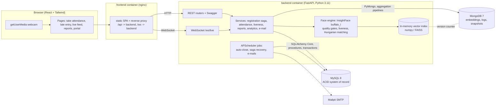
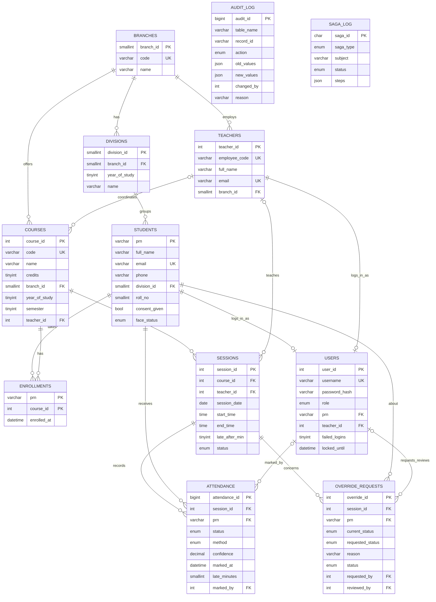
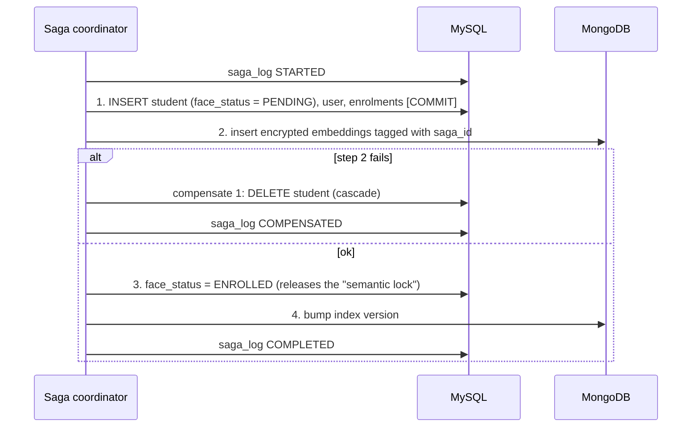
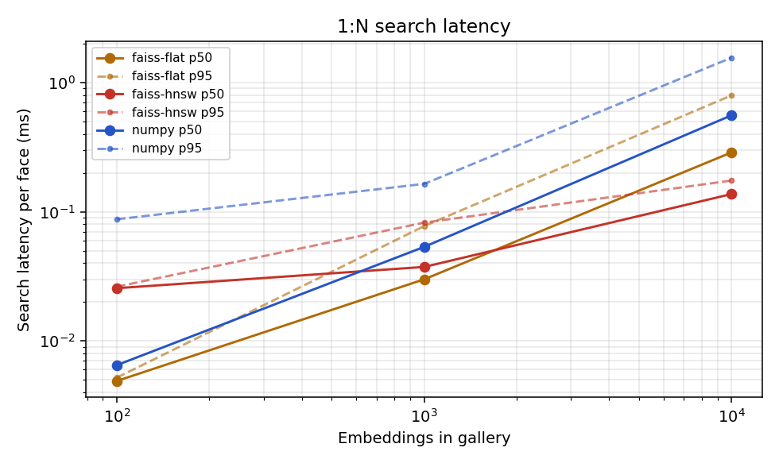
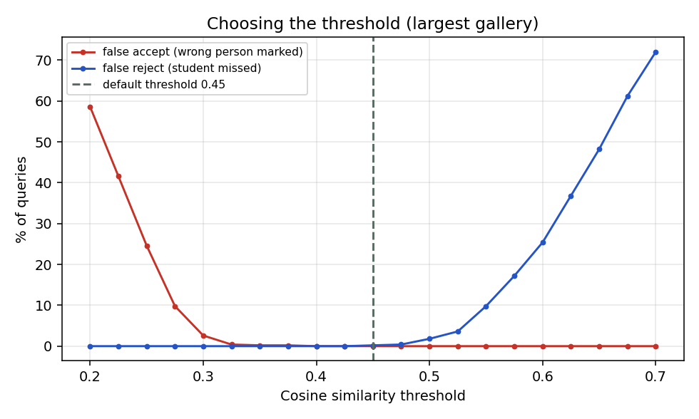

# Smart Face Recognition Attendance System

A polyglot-persistence DBMS project for **VIT Pune, B.Tech CS**. Teachers take the register from one photo of the
class, late students check in at the door with a blink or a head-turn liveness check, and students see their own
attendance and how far they are from 75 %.

* **MySQL 8** is the system of record (ACID): students, courses, sessions, attendance, users, audit log, overrides, saga log.
* **MongoDB 7** holds high-volume, schema-flexible data (BASE): encrypted face embeddings, recognition logs, snapshots,
  notifications, spoof attempts, the review queue.
* **InsightFace `buffalo_l`** (RetinaFace detector + ArcFace 512-d embeddings) with OpenCV; `face_recognition` (dlib)
  and a pure-OpenCV engine as fallbacks.
* **FastAPI** (REST + WebSocket, Swagger at `/docs`) and a **React + Tailwind** single-page app (dark/light, mobile ready).

---

## Contents

1. [Quick start (5 commands)](#1-quick-start-5-commands)
2. [Architecture](#2-architecture)
3. [Why two databases (ACID vs BASE)](#3-why-two-databases-acid-vs-base)
4. [MySQL design: ER diagram, 3NF, indexes, EXPLAIN](#4-mysql-design)
5. [Views, procedures, triggers, transactions, GRANT roles](#5-views-procedures-triggers-transactions-grants)
6. [MongoDB design](#6-mongodb-design)
7. [Cross-database consistency: the saga pattern](#7-cross-database-consistency-the-saga-pattern)
8. [Face pipeline, liveness and security](#8-face-pipeline-liveness-and-security)
9. [API](#9-api)
10. [Tests](#10-tests)
11. [Benchmark](#11-benchmark)
12. [Synthetic data](#12-synthetic-data)
13. [Demo script for the viva](#13-demo-script-for-the-viva)
14. [Screenshots checklist](#14-screenshots-checklist)
15. [Privacy and the right to be forgotten](#15-privacy-and-the-right-to-be-forgotten)
16. [Folder structure](#16-folder-structure)
17. [Troubleshooting and known limits](#17-troubleshooting-and-known-limits)

More: [docs/DATABASE.md](docs/DATABASE.md) (every collection with sample documents, all pipelines),
[docs/VIVA_QA.md](docs/VIVA_QA.md) (25 viva questions with answers),
[docs/sql/explain_examples.sql](docs/sql/explain_examples.sql), [docs/mongo/aggregations.js](docs/mongo/aggregations.js).

---

## 1. Quick start (5 commands)

Requirements: Docker Desktop (or Docker Engine + Compose v2), ~6 GB free disk, internet on the first build.

```bash
git clone <your-repo-url> smart-attendance
```

```bash
cd smart-attendance
```

```bash
cp .env.example .env
```

```bash
docker compose up --build
```

```bash
open http://localhost:3000
```

(Edit the `change_me` passwords in `.env` before the 4th command if this is anything more than a local demo.
On Linux use `xdg-open`, on Windows just open the URL.)

| What | Where |
|---|---|
| Web app | http://localhost:3000 |
| Swagger / OpenAPI | http://localhost:8000/docs (ReDoc: `/redoc`) |
| Captured e-mails (Mailpit) | http://localhost:8025 |
| MySQL | `localhost:3307` (users from `.env`) |
| MongoDB | `localhost:27018` |

**Sign in**

| Role | Username | Password |
|---|---|---|
| Admin | `ADMIN_EMAIL` from `.env` (`admin@example.org`) | `ADMIN_PASSWORD` |
| Teacher (seeded) | `anjali.deshmukh@faculty.example.org` (DBMS coordinator) | `DEMO_USER_PASSWORD` |
| Student (seeded) | `12310001` … `12310020` | `DEMO_USER_PASSWORD` |

First boot notes:

* The backend image downloads the InsightFace `buffalo_l` model (~280 MB) at build time (`PRELOAD_MODELS=true`).
  If that fails offline, it downloads on first start; `/health` shows `engine.status = loading` meanwhile.
* `JWT_SECRET` and `EMBEDDING_ENC_KEY` are generated on first boot and persisted in the `backend_data` volume
  if left empty. Back that volume up: without the key the encrypted embeddings cannot be read.
* Browsers only allow the webcam on `https://` or `http://localhost`. To use a phone on your LAN, put the app
  behind HTTPS (for example a reverse proxy with a self-signed certificate) or use the upload option.
* Reset everything: `docker compose down -v` (deletes both databases and the generated secrets).

---

## 2. Architecture



Request path of a group photo:

```mermaid
sequenceDiagram
  participant T as Teacher (browser)
  participant A as FastAPI
  participant F as Face engine + index
  participant G as MongoDB
  participant M as MySQL
  T->>A: POST /attendance/group (photo, session_id)
  A->>M: session OPEN? course roster
  A->>F: detect all faces, 512-d embeddings
  F->>F: cosine vs enrolled students, Hungarian assignment
  A->>G: draft + recognition_logs + annotated snapshot (best effort)
  A-->>T: annotated image, matches, unknown faces, roster
  T->>A: POST /attendance/group/confirm (ticked PRNs, manual additions + reasons)
  A->>G: lock draft OPEN -> COMMITTING (double-submit guard)
  A->>M: BEGIN; CALL mark_attendance() per student; COMMIT (all or nothing)
  A->>G: draft COMMITTED, review queue for unsure faces
  A-->>T: inserted / duplicates
  A--)T: WebSocket event attendance_committed
```

---

## 3. Why two databases (ACID vs BASE)

Attendance decides whether a student may sit an exam, so it must never be half-written, duplicated or silently lost:
that is a job for a relational, ACID database with constraints, triggers and transactions. Face embeddings and logs
are large, numerous, append-mostly and their shape changes with the model (512-d ArcFace vs 128-d dlib, extra
quality fields). Losing a log line is acceptable; blocking attendance because a log could not be written is not.
That is a job for a document store with relaxed (BASE) guarantees.

### MySQL tables (ACID)

| Table | Holds | Why relational / ACID |
|---|---|---|
| `students` | profile, PRN, division, consent, face status | Identity of record; UNIQUE email, UNIQUE (division, roll); CHECK consent = TRUE; PRN is the cross-DB key |
| `teachers` | staff profiles | FK target for courses and sessions |
| `users` | login principals (bcrypt hash, role, lockout) | Exactly one user per student/teacher (UNIQUE FKs), role consistency trigger |
| `branches`, `divisions` | CS / IT / ...; (branch, year, division) | Lookup tables that remove a transitive dependency (3NF) |
| `courses` | course, credits, semester, coordinator | CHECK semester belongs to year; FK coordinator ON DELETE SET NULL |
| `enrollments` | M:N students-courses | Composite PK (prn, course_id) |
| `sessions` | one lecture with time window and status | UNIQUE (course, date, start), CHECK end > start, status machine enforced by procedures |
| `attendance` | one mark per (session, student) | **UNIQUE (session_id, prn)** makes duplicate marking impossible even under concurrency; ENUM status |
| `override_requests` | manual corrections with reason | Workflow state + CHECKs; applied through a procedure, audited by triggers |
| `audit_log` | who changed what, when, why | Append-only: written by triggers, application user has SELECT only |
| `saga_log` | state of cross-DB sagas | Durable, transactional state needed for compensation and crash recovery |
| `app_meta` | schema version, shortage threshold | One source for the 75 % rule used by views and API |

### MongoDB collections (BASE)

| Collection | Holds | Why a document store |
|---|---|---|
| `face_embeddings` | 5-15 encrypted vectors per student + pose and quality | Variable count per student, binary payload, model-dependent shape; read in bulk into the vector index |
| `recognition_logs` | one document per detected face (status, confidence, latency) | Very high write volume, no joins, **TTL 90 days**, aggregation pipelines for analytics |
| `snapshots` | annotated class photos, unknown-face crops, spoof frames | Binary blobs up to a few hundred KB, **TTL 30 days** (privacy) |
| `attendance_drafts` | "analyse -> confirm" state of a photo | Short-lived (TTL on `expires_at`), nested face arrays, atomic `find_one_and_update` lock |
| `notifications` | in-app inbox (late, shortage, unknown face, spoof) | Fan-out documents with per-user `read_by` arrays |
| `spoof_attempts` | blocked liveness checks with metrics | Flexible metrics per detector, time-series style queries |
| `review_queue` | uncertain matches waiting for a human | Embeds the candidate list and the encrypted embedding |
| `liveness_nonces` | used challenge nonces | UNIQUE index for replay protection + TTL |
| `meta` | vector-index version counter | Cache coherence of in-memory indexes across workers |

If MongoDB is down, attendance still works: drafts fall back to memory, logs are skipped with a warning, and the
cached vector index keeps matching. If MySQL is down, the API answers 503 instead of guessing.

---

## 4. MySQL design

### ER diagram



`audit_log` and `saga_log` deliberately have **no foreign keys**: the audit trail must outlive the user and the
student it describes, and a saga row must survive the compensation that deletes its subject.

### Normalisation (3NF)

* **1NF**: every column is atomic (no lists of PRNs in a session row; attendance is one row per student per session).
* **2NF**: the only composite key is `enrollments (prn, course_id)` and it has no partially dependent attribute
  (`enrolled_at` depends on the whole key). `attendance` uses a surrogate key plus `UNIQUE(session_id, prn)`;
  every attribute (status, method, confidence, marked_at) depends on the whole (session, student) pair.
* **3NF**: no transitive dependencies.
  * A student's branch and year depend on the division, so they live in `divisions`, not in `students`.
  * A session's course name lives in `courses`; `attendance` stores only `session_id`, never the date or course.
  * Percentages are **not stored**; they are derived by views, so they can never contradict the marks.
* **Controlled denormalisation**: `attendance.late_minutes` is derivable from `marked_at` and the session start, but
  is kept for reporting speed and historical stability. Triggers recompute it on every insert/update, so it cannot drift.

### Constraints that encode rules

`CHECK (consent_given = TRUE)` (no biometric profile without consent), PRN / e-mail / phone format via `REGEXP_LIKE`,
`CHECK (semester BETWEEN year*2-1 AND year*2)`, `CHECK (end_time > start_time)`, confidence between 0 and 1 and
required for face-based marks, `CHECK (CHAR_LENGTH(TRIM(reason)) >= 5)` on overrides, and
`CHECK ((status = 'PENDING') = (reviewed_at IS NULL))`. Role/link consistency of `users` is a trigger, because
MySQL forbids CHECK constraints on columns used by `ON DELETE CASCADE` foreign keys (error 3823).

`ON DELETE` rules: deleting a student **cascades** to users, enrollments, attendance and override requests;
deleting a course cascades to its sessions and their attendance; deleting a teacher sets course coordinator and
session teacher to NULL; lookups (`branches`, `divisions`) are RESTRICT. `ON UPDATE RESTRICT` everywhere because
PRN is the join key with MongoDB and therefore immutable.

### Indexes and why

| Index | Serves |
|---|---|
| `attendance UNIQUE (session_id, prn)` | duplicate protection; also "all marks of a session" through its left prefix |
| `attendance (prn, status)` | per-student report and percentage views (covering index for `GROUP BY status`) |
| `attendance (marked_at)` | daily summaries and time-range audits |
| `sessions UNIQUE (course_id, session_date, start_time)` | no double booking; course timeline via left prefix |
| `sessions (session_date, status)` | "today's open sessions", daily trend |
| `sessions (teacher_id, session_date)` | teacher's daily summary e-mail |
| `sessions (status, session_date)` | auto-close job (`status = 'OPEN' AND end < now`) |
| `enrollments PK (prn, course_id)` + `(course_id)` | both directions of the M:N relation |
| `students UNIQUE (division_id, roll_no)`, `(face_status)`, `(full_name)` | roll numbers, enrolment dashboards, search |
| `audit_log (table_name, record_id)`, `(changed_at)`, `(action, changed_at)` | audit viewer filters |
| `saga_log (status, updated_at)` | recovery job finds stale sagas |

### EXPLAIN (captured on the seeded database)

```sql
EXPLAIN SELECT status FROM attendance WHERE session_id = 3 AND prn = '12310005';
-- type=const  key=uq_attendance_session_prn  rows=1          -> single row through the unique key

EXPLAIN SELECT status, COUNT(*) FROM attendance WHERE prn = '12310005' GROUP BY status;
-- type=ref    key=idx_attendance_prn_status  rows=10  Extra=Using index    -> covering index, no table access

ALTER TABLE attendance ALTER INDEX idx_attendance_prn_status INVISIBLE;   -- same query without the index
-- type=ALL    key=NULL  rows=205  Extra=Using where; Using temporary       -> full scan + temp table

EXPLAIN SELECT * FROM sessions WHERE session_date = CURDATE() AND status = 'OPEN';
-- type=ref    key=idx_sessions_date_status  ref=const,const  rows=1  Extra=Using index condition
```

More queries (including `EXPLAIN ANALYZE` of the views) in [docs/sql/explain_examples.sql](docs/sql/explain_examples.sql).

---

## 5. Views, procedures, triggers, transactions, GRANTs

All in [db/mysql/01_schema.sql](db/mysql/01_schema.sql).

**Views** (derived data, never stored): `v_student_course_attendance`, `v_student_attendance_pct` (with
`is_shortage`), `v_course_summary`, `v_session_summary`, `v_shortage_list`. The 75 % threshold is read from `app_meta`.

**Stored procedures** (errors via `SIGNAL SQLSTATE '45000'`, mapped to HTTP codes by the API):

| Procedure | Does |
|---|---|
| `mark_attendance(session, prn, method, conf, by, OUT result)` | checks session OPEN (`FOR SHARE` lock) and enrolment, inserts PRESENT; duplicate key handler returns `DUPLICATE` |
| `mark_late(..., OUT minutes, OUT result)` | `FOR UPDATE` on the slot; `ALREADY_MARKED` if present; within grace -> PRESENT; upgrades an auto-ABSENT |
| `get_student_report(prn)` | three result sets: summary, per course, lecture history |
| `open_session(session, force, early_min)` | SCHEDULED -> OPEN only inside the time window unless forced |
| `close_session(session, by, OUT absent)` | `FOR UPDATE` (waits for in-flight markers), inserts ABSENT for the rest, CLOSED |
| `auto_close_expired_sessions(grace, OUT n)` | **cursor** over open sessions past their end time |
| `apply_override(id, reviewer, note)` | upsert with `INSERT ... AS new_row ON DUPLICATE KEY UPDATE`, sets audit context |
| `forget_student(prn, actor, OUT n)` | `SQL SECURITY DEFINER`: pseudonymises audit rows, deletes the student (cascades) |

**Triggers**: `trg_attendance_bi/bu` auto-calculate `late_minutes`; `trg_attendance_ai/au/ad` write the audit log
(manual inserts, every update, deletes) with the actor and reason taken from session variables `@app_user_id`,
`@audit_reason`, `@audit_action` that the API sets inside the same transaction (and resets on every pooled
connection checkout); `trg_users_bi/bu` enforce role/link consistency; `trg_students_au/ad` audit profile changes
and erasures (an erasure stores only the SHA-256 of the PRN); `trg_override_au` audits decisions.
Note for the viva: MySQL does **not** fire triggers for rows removed by a foreign-key cascade.

**Transactions**: confirming a class photo runs `BEGIN; CALL mark_attendance(...)` for every student;
`COMMIT` — if any student is not enrolled, the session was closed meanwhile or the database fails, everything is
rolled back (tested in `test_confirm_is_all_or_nothing`). `FOR SHARE` / `FOR UPDATE` locks make closing a session
wait for in-flight marking. CSV import can run all-or-nothing (`?atomic=true`).

**GRANT-based roles** ([db/mysql/03_roles.sh](db/mysql/03_roles.sh), passwords from `.env`):

| MySQL user | Role | Rights |
|---|---|---|
| `attendance_app` (the API) | `role_app_rw` | CRUD on operational tables, `EXECUTE` on procedures, **SELECT only on `audit_log`** |
| `attendance_admin` | `role_dba` | `ALL` on the schema |
| `attendance_report` | `role_reporting_ro` | `SELECT` on the five views only |

The application therefore cannot rewrite history: `DELETE FROM audit_log` as the app user fails with error 1142,
yet the triggers (running as their definer) can append, and `forget_student()` (definer rights) can pseudonymise.

---

## 6. MongoDB design

Collections are created with `$jsonSchema` validators by [db/mongo/init-mongo.js](db/mongo/init-mongo.js) and
re-applied idempotently by the API (`app/db/mongo_schema.py`). Key indexes:

* `face_embeddings (prn, created_at)`, `(model, active)`, `(saga_id)` sparse
* `recognition_logs (prn, created_at)`, `(status, created_at)`, **TTL on `created_at` (90 days)**
* `snapshots` TTL 30 days, `notifications` TTL 180 days, `attendance_drafts` TTL on `expires_at`
* `liveness_nonces` UNIQUE `nonce` + TTL 10 minutes

Sample document (`face_embeddings`):

```json
{
  "_id": {"$oid": "6710c2..."},
  "prn": "12310005",
  "model": "insightface-buffalo_l",
  "dim": 512,
  "embedding_enc": {"$binary": "gAAAAABnEMK...", "$type": "00"},
  "pose": "left", "yaw": -21.4,
  "quality": {"brightness": 128.4, "sharpness": 74.1, "face_px": 212, "det_score": 0.91},
  "source": "REGISTRATION", "active": true,
  "saga_id": "80622c29-eb12-49ed-a20e-6e0c63f24338",
  "created_at": {"$date": "2026-10-19T10:39:44Z"}
}
```

Aggregation pipelines (code in `app/repositories/logs.py` and `notifications.py`, mongosh versions in
[docs/mongo/aggregations.js](docs/mongo/aggregations.js)): **low-confidence matches** per student, **daily
recognition stats** (matched / unsure / unknown, average confidence and latency), **spoof attempts per day** with a
breakdown by reason (`$facet`). All collections and sample documents: [docs/DATABASE.md](docs/DATABASE.md).

**Vector search**: an in-memory index (`app/face/matcher.py`) decrypts embeddings once and searches with exact
cosine similarity in numpy (`max` over a student's templates via `np.maximum.reduceat`); FAISS is used for large
galleries. A version counter in `meta` tells every worker when to reload. Atlas Vector Search would also work but
requires MongoDB Atlas and would need the embeddings unencrypted.

---

## 7. Cross-database consistency: the saga pattern

There is no distributed transaction between MySQL and MongoDB, so every operation that touches both is a **saga**:
a sequence of local transactions with compensations, persisted in `saga_log` (`app/services/saga.py`).



* **REGISTER**: as above. `PENDING` is a semantic lock: a student is never recognisable until both halves exist.
* **DELETE / FORGET**: 1) soft-delete embeddings (`active=false`, recognition stops at once; compensation = restore),
  2) **pivot**: MySQL delete / `forget_student()` (no way back), 3) purge MongoDB (idempotent, retried forward).
* **ADD_PHOTOS** (re-enrolment): insert new templates, then retire old ones (pivot), then mark ENROLLED.
* **Recovery**: a job every 10 minutes (and on start-up) completes or compensates sagas stuck in STARTED/COMPENSATING.

Tested: `test_registration_rolls_back_mysql_when_mongo_fails`, `test_delete_rolls_back_when_mysql_step_fails`,
`test_forget_me_cascades_across_both_databases`, plus unit tests of the coordinator.

---

## 8. Face pipeline, liveness and security

| Stage | Implementation |
|---|---|
| Detection + embedding | InsightFace `buffalo_l`: RetinaFace (det_10g) + ArcFace (w600k_r50, 512-d, L2-normalised) + 68-point 3D landmarks for head pose |
| Quality gates | exactly one face, min 80 px face, sharpness (Laplacian variance on a 160 px crop, default 30, calibrated on real faces), brightness 50-210, contrast, back-light, detector score |
| Registration | 5-10 photos, outliers rejected if not the same person, head-turn spread of at least 10 degrees, **duplicate face blocked** (similarity >= 0.60 to another PRN) |
| Matching | cosine similarity, threshold **0.45** (configurable per request); bands: matched >= T+0.08 > low confidence >= T > possible >= T-0.08; Hungarian assignment so two faces never get the same student |
| Group photo | annotated image, unknown faces listed with crops and nearest suggestions, teacher confirms before the atomic save |
| Late entry | exactly one face; random one-time **liveness challenge** (blink or head turn) signed as a short-lived token, nonce burnt in MongoDB (replay blocked) |
| Anti-spoofing | head-turn yaw range, blink via eye-aspect-ratio, identity consistency across frames, "too static" detection (photo or frozen video), moire (screen re-capture) and glare cues; every blocked attempt goes to `spoof_attempts` with a snapshot |
| Review + re-enrolment | possible matches go to a review queue; approving can store the face as a new template; when a student's recent confidence drifts towards the threshold, a fresh template is learnt automatically (capped at 15) |
| Encryption at rest | embeddings encrypted with Fernet (AES-128-CBC + HMAC-SHA256), key rotation through `MultiFernet` |
| Auth | bcrypt passwords, JWT (HS256) with role claims, lockout after 5 failures, one-time passwords for new students |

Why 0.45? See the threshold sweep in [section 11](#11-benchmark): false accepts disappear around 0.40, false
rejects start rising above 0.50.

---

## 9. API

Full interactive documentation: **http://localhost:8000/docs**. Main endpoints:

| Method | Path | Who | Purpose |
|---|---|---|---|
| POST | `/auth/login` | all | form login, returns JWT |
| GET | `/auth/me`, POST `/auth/change-password` | all | profile, password |
| POST | `/students/register` | staff | profile + 5-10 photos (REGISTER saga) |
| POST | `/students/quality-check` | staff | check one photo while capturing |
| POST | `/students/{prn}/photos` | staff | re-enrol / add templates |
| POST | `/students/import` | staff | bulk CSV import (`?atomic=true`) |
| GET/PUT | `/students`, `/students/{prn}` | staff | list, view, update (audited) |
| DELETE | `/students/{prn}` | admin | DELETE saga |
| POST | `/students/{prn}/forget` | admin or self | right to be forgotten (FORGET saga) |
| POST | `/attendance/group` + `/attendance/group/confirm` | staff | analyse class photo, then atomic save |
| GET | `/liveness/challenge`, POST `/attendance/late` | staff | solo late entry with liveness |
| POST | `/attendance/qr` | student | QR / code fallback |
| GET | `/attendance/student/{prn}`, `/attendance/course/{id}`, `/attendance/date/{day}`, `/attendance/shortage` | staff / self | reports |
| GET/POST | `/sessions`, `/sessions/{id}/open`, `/close`, `/cancel`, `/qr` | staff | time window, rotating QR |
| POST/GET | `/overrides`, `/overrides/{id}/approve`, `/reject` | all / staff | corrections workflow |
| GET/POST | `/review`, `/review/{id}/approve`, `/reject` | staff | low-confidence queue |
| GET | `/reports/export?type=csv\|xlsx\|pdf&scope=student\|course\|date\|shortage` | staff / self | exports |
| GET | `/analytics/summary`, `/daily-trend`, `/course-wise`, `/heatmap`, `/top-bottom`, `/spoof-per-day`, `/recognition-stats`, `/low-confidence` | staff | dashboard |
| GET | `/notifications`, POST `/notifications/read` | all | inbox |
| WS | `/ws/live?token=JWT` | all | live recognition frames + real-time events |
| GET | `/health`, `/config/public`; `/admin/jobs/{job}`, `/admin/sagas`, `/admin/audit` | admin | operations |

Errors always look like `{"detail": "...", "code": "SESSION_NOT_OPEN", "request_id": "..."}`.

---

## 10. Tests

54 tests: 14 unit tests (quality gates, matcher, Hungarian assignment, liveness, encryption, saga coordinator) and
40 integration tests against **real MySQL and MongoDB** using dedicated test schemas (`attendance_test`,
`attendance_logs_test`, created by the init scripts). A deterministic fake face engine replaces the neural network,
so everything else (procedures, triggers, constraints, sagas, TTL collections, WebSocket) runs for real.

```bash
docker compose run --rm backend pytest -q
```

| Area | Tests |
|---|---|
| Registration | stores profile + encrypted templates, consent mandatory, photo count, bad quality (no face, two faces, dark, small), pose variety, CSV import |
| Duplicates | same face with another PRN blocked, same PRN rejected, UNIQUE(session, prn) raises 1062, double submission of a draft, late after present |
| Group marking | recognition statuses, nothing written before confirm, **all-or-nothing confirm**, manual additions audited by trigger, close marks absentees, live WebSocket flow |
| Late marking | LATE with correct minutes, within grace = PRESENT, multiple faces, no face, unknown person |
| Spoof block | static photo blocked and logged in `spoof_attempts`, challenge replay blocked, challenge required |
| Saga rollback | Mongo outage during registration compensates MySQL; failed delete restores templates; forget-me erases both databases and pseudonymises the audit log |
| Other | overrides audited, student scope, QR codes, CSV/XLSX/PDF exports, analytics endpoints, login lockout |

---

## 11. Benchmark

```bash
docker compose exec backend python -m scripts.benchmark
```

Generates `benchmarks/results.json`, `results.csv`, `latency.png`, `accuracy.png` and `threshold.png`. The gallery
is synthetic but shaped like ArcFace score distributions (lookalike clusters, noisy captures; `--difficulty`
easy / realistic / hard). Results of a run on an Apple-silicon laptop (single query = one face; batch = one group photo):

| Backend | Embeddings | p50 ms | p95 ms | Top-1 accuracy | False accepts | Batch faces/s |
|---|---:|---:|---:|---:|---:|---:|
| numpy (production) | 100 | 0.007 | 0.088 | 99.8 % | 0 % | 396 878 |
| faiss-flat | 100 | 0.005 | 0.005 | 99.8 % | 0 % | 129 597 |
| faiss-hnsw | 100 | 0.026 | 0.026 | 99.8 % | 0 % | 121 460 |
| numpy (production) | 1 000 | 0.054 | 0.164 | 100 % | 0 % | 139 473 |
| faiss-flat | 1 000 | 0.030 | 0.078 | 100 % | 0 % | 699 016 |
| faiss-hnsw | 1 000 | 0.037 | 0.082 | 100 % | 0 % | 90 140 |
| numpy (production) | 10 000 | 0.559 | 1.560 | 99.8 % | 0 % | 19 106 |
| faiss-flat | 10 000 | 0.288 | 0.797 | 99.8 % | 0 % | 95 691 |
| faiss-hnsw | 10 000 | 0.137 | 0.175 | 99.8 % | 0 % | 35 631 |

Threshold sweep at 10 000 embeddings: false accepts 2.6 % at 0.30, 0.2 % at 0.35, 0 % from 0.40; false rejects
0.2 % at 0.45, 1.8 % at 0.50, 9.8 % at 0.55. The search itself costs well under 2 ms; the dominant cost is the
neural network: **~0.8 s per 1280 px class photo with 6 faces on CPU** (measured with the real model), so a whole
class is processed in about a second.

 

---

## 12. Synthetic data

```bash
docker compose exec backend python -m scripts.generate_synthetic_data --students 60 --days 30
```

Adds students `SYN0000001...` (division CS-2-B by default) with realistic attendance (per-student propensity,
Monday dip, more lateness in the first slot), encrypted synthetic embeddings, recognition logs, spoof attempts and
notifications, so the analytics pages have something to show. Remove everything with `--purge`.

---

## 13. Demo script for the viva

1. `docker compose up --build`, open http://localhost:3000, sign in as the admin. Show `/health` and Swagger.
2. **Register yourself** (Students, Register a student): fill the form, tick consent, take the guided photos (each
   is checked live: try one in the dark or with a friend in frame to show the quality gate). Show the one-time
   password. In MongoDB Compass show that `face_embeddings.embedding_enc` is binary ciphertext.
3. Try to register the same face with another PRN: **blocked as a duplicate**.
4. Sessions: create a session with "open now" (or open the scheduled one; outside its time window it is refused).
5. **Take attendance**: photograph 3-4 people; show the annotated image, the unknown face, the register; untick and
   re-tick, add one student by hand with a reason; Save. Point at `audit_log` (Admin, Audit trail) for the manual entry.
6. Save the same draft again (browser back + Save) -> "already submitted". Take another photo -> nobody marked twice.
7. **Late entry**: start the check and follow the blink/head-turn instruction -> marked LATE with minutes. Then hold a
   phone photo of yourself to the camera -> **liveness failed**; show the attempt in Analytics (spoof attempts per day).
8. **Live recognition**: start it, walk in front of the camera, save the seen list.
9. Class code: open the QR on a session, sign in as a student on a phone, type the code.
10. Close the session -> everybody else becomes ABSENT (procedure `close_session`).
11. Reports: export the course register as Excel and PDF; show the shortage tab and "E-mail shortage alerts now",
    then the e-mails in Mailpit (http://localhost:8025).
12. Corrections: as a student request a correction; as the teacher approve it; show the OVERRIDE audit row.
13. SQL: in MySQL Workbench run `CALL get_student_report('12310005');`, `SELECT * FROM v_shortage_list;`, the
    EXPLAIN examples, and show `DELETE FROM audit_log` failing as `attendance_app`.
14. **Saga**: `docker compose stop mongo`, try to register -> rolled back (Admin, Sagas shows COMPENSATED);
    `docker compose start mongo`.
15. **Forget me**: as the student, Erase my data -> both databases cleaned, audit row pseudonymised (ERASE).
16. `docker compose run --rm backend pytest -q` -> 54 passed. Show the benchmark charts.

---

## 14. Screenshots checklist

- [ ] Login page (dark) and the same page in light theme
- [ ] Dashboard with ledger figures and today's sessions
- [ ] Registration with the guided photo strip (one rejected photo visible)
- [ ] Duplicate-face error
- [ ] Group photo analysed: annotated image + register with ink marks
- [ ] Saved toast and the marks after saving
- [ ] Late entry: challenge overlay, success card, liveness failure with reasons
- [ ] Live recognition with boxes and the seen list
- [ ] Sessions list + rotating QR modal
- [ ] Reports: course register, student report, shortage list, an exported PDF and Excel file
- [ ] Analytics: daily trend, course bars, calendar heatmap, spoof attempts per day
- [ ] Review queue and corrections (pending, approved)
- [ ] Admin: audit trail with a diff, saga log (COMPLETED and COMPENSATED), system health
- [ ] Student portal on a phone (shortage warning, lecture history)
- [ ] Mailpit inbox with a shortage alert and a daily summary
- [ ] Swagger UI, MySQL Workbench (EXPLAIN, procedure call, GRANT error), MongoDB Compass (TTL index, encrypted binData)
- [ ] Terminal: `pytest` 54 passed, benchmark table

---

## 15. Privacy and the right to be forgotten

*(use this as the privacy slide)*

* **Consent first**: a face profile cannot exist without consent; enforced by a `CHECK` constraint, not only the UI.
* **Data minimisation**: registration photos are converted to templates and discarded; only templates are kept.
  Snapshots (annotated photos, unknown faces) expire after 30 days and recognition logs after 90 days (TTL indexes).
* **Encryption at rest**: every template is Fernet-encrypted with a key that lives outside the database.
* **Least privilege**: the API's database user cannot change or delete audit rows, and the reporting user can only
  read the aggregated views, never the raw student table.
* **Purpose limitation**: templates are used only to mark attendance in courses the student is enrolled in
  (matching is restricted to the course roster).
* **Transparency**: students see every mark, how it was recorded (photo, late entry, code, manual) and can request
  corrections, which are logged with a reason.
* **Right to be forgotten** (`POST /students/{prn}/forget`, "Erase my data" in the portal): a FORGET saga removes
  the profile, account, enrolments, attendance, overrides (MySQL cascade), templates, recognition logs, snapshots,
  notifications, spoof records and review items (MongoDB), and pseudonymises the audit trail with SHA-256 of the PRN
  so the accountability record survives without identifying the person. The response is an erasure receipt.
* Aligned with India's **Digital Personal Data Protection Act 2023** (consent, purpose limitation, erasure) and
  GDPR Article 9 (biometric data as special category).

---

## 16. Folder structure

```
smart-attendance/
├── docker-compose.yml          mysql, mongo, mailpit, backend, frontend
├── .env.example                every setting, no secrets committed
├── db/
│   ├── mysql/
│   │   ├── 01_schema.sql       tables, constraints, indexes, views, triggers, procedures
│   │   ├── 02_seed.sql         5 branches, 60 divisions, 4 teachers, 3 courses, 20 students, 10 sessions
│   │   └── 03_roles.sh         GRANT roles/users + pytest schema
│   └── mongo/init-mongo.js     app user, validators, compound + TTL indexes
├── backend/
│   ├── Dockerfile, requirements*.txt, constraints.txt, pytest.ini
│   ├── app/
│   │   ├── main.py             FastAPI app, lifespan, routers
│   │   ├── config.py           settings + generated secrets
│   │   ├── core/               errors, JWT/bcrypt, Fernet, auth deps, middleware
│   │   ├── db/                 MySQL (SQLAlchemy Core), MongoDB, Mongo schema
│   │   ├── face/               engines, quality, liveness, vector index, annotation
│   │   ├── repositories/       SQL and Mongo access per aggregate
│   │   ├── services/           saga, registration, privacy, attendance, overrides, reports, analytics, e-mail, jobs
│   │   ├── routers/            auth, students, attendance, academic, workflow, reports, admin, ws
│   │   ├── schemas/            Pydantic models
│   │   └── ws/manager.py       WebSocket fan-out
│   ├── scripts/                benchmark, synthetic data generator, model preload
│   └── tests/                  unit + integration tests, fake face engine
├── frontend/
│   ├── Dockerfile, nginx.conf, package.json, vite/tailwind config
│   └── src/
│       ├── api/client.js       fetch wrapper, downloads, WebSocket URL
│       ├── context/            auth, theme, toasts
│       ├── hooks/              webcam, live socket, data loading, authed images
│       ├── components/         layout, camera, session picker, photo capture, heatmaps, UI kit
│       └── pages/              login, dashboard, take attendance, late entry, live, sessions, students,
│                               register, import, review, corrections, reports, analytics, admin, portal, QR
├── benchmarks/                 benchmark output (JSON, CSV, charts)
└── docs/
    ├── DATABASE.md             MongoDB schemas, sample documents, pipelines; MySQL object reference
    ├── VIVA_QA.md              25 DBMS viva questions with answers
    ├── sql/explain_examples.sql
    └── mongo/aggregations.js
```

---

## 17. Troubleshooting and known limits

* **`engine.status = failed`** in `/health`: the model could not be downloaded. Check internet access and rebuild, or
  set `FACE_ENGINE=opencv` for a demo-quality fallback (lower accuracy).
* **Camera does not start**: use `http://localhost` or HTTPS; allow camera permission; close other apps using it.
* **Backend restarts while MySQL initialises**: normal on the first `up`; compose waits for the health checks.
* **Port in use**: change the `*_HOST_PORT` variables in `.env`.
* **Apple silicon**: all images are multi-arch; the first build compiles InsightFace's small Cython extension.
* **Liveness limits**: challenge-response with blink/head turn defeats printed photos and still images on screens;
  a high-quality replayed video of the right person performing the right random challenge could still pass.
  Production systems add depth/IR cameras or a trained presentation-attack-detection model.
* **Single worker**: the scheduler and the in-memory index live in one process. More workers stay consistent
  (index version counter) but each would run the scheduler; move jobs to a separate container to scale out.
